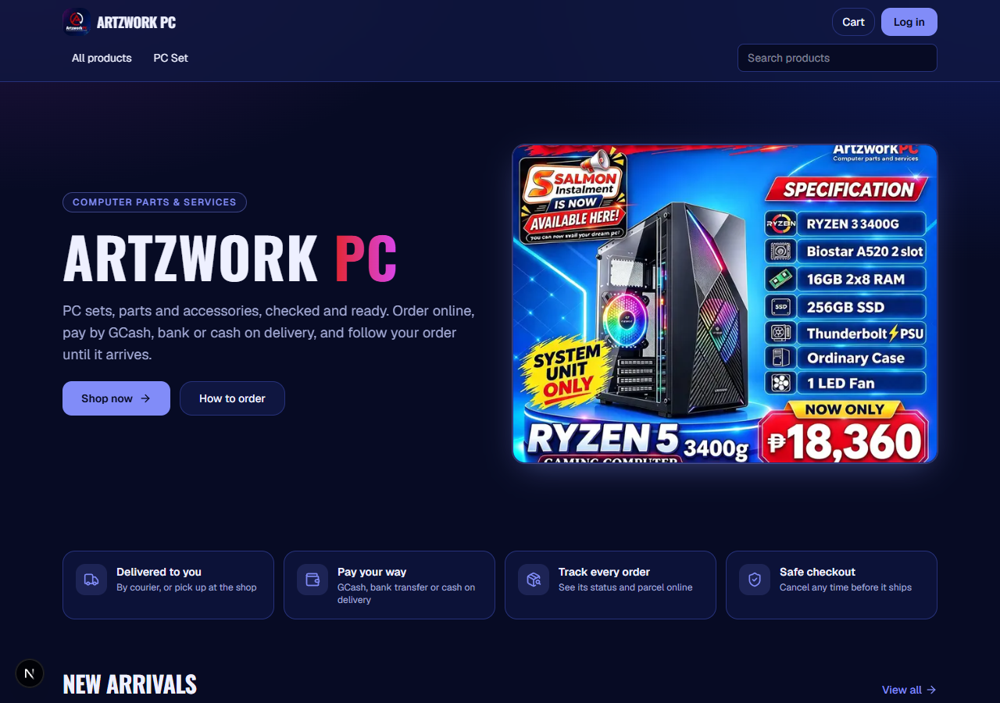
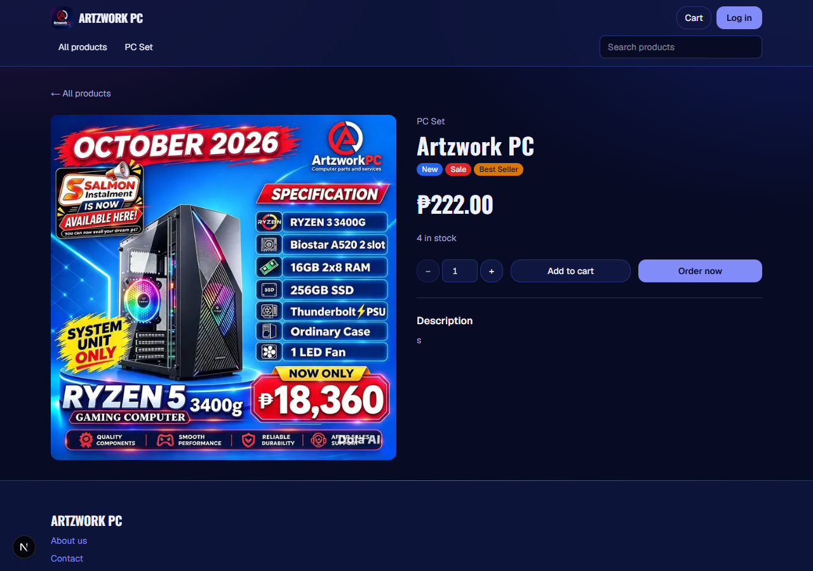
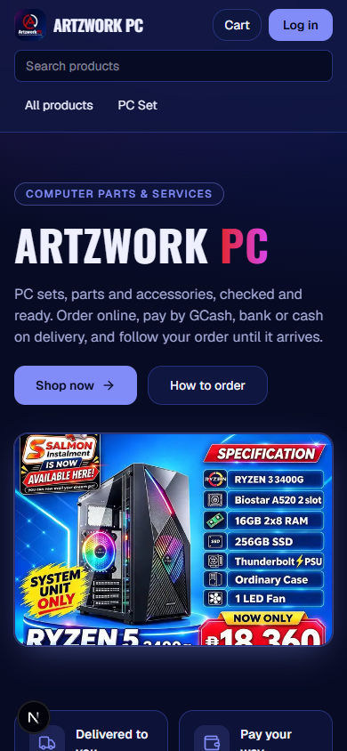
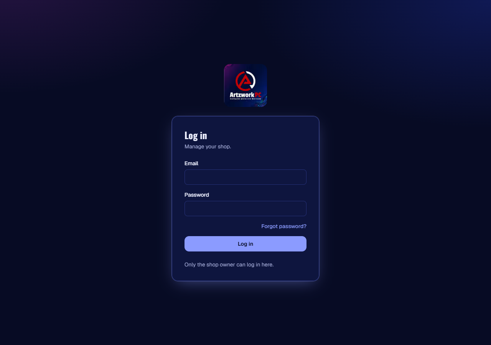
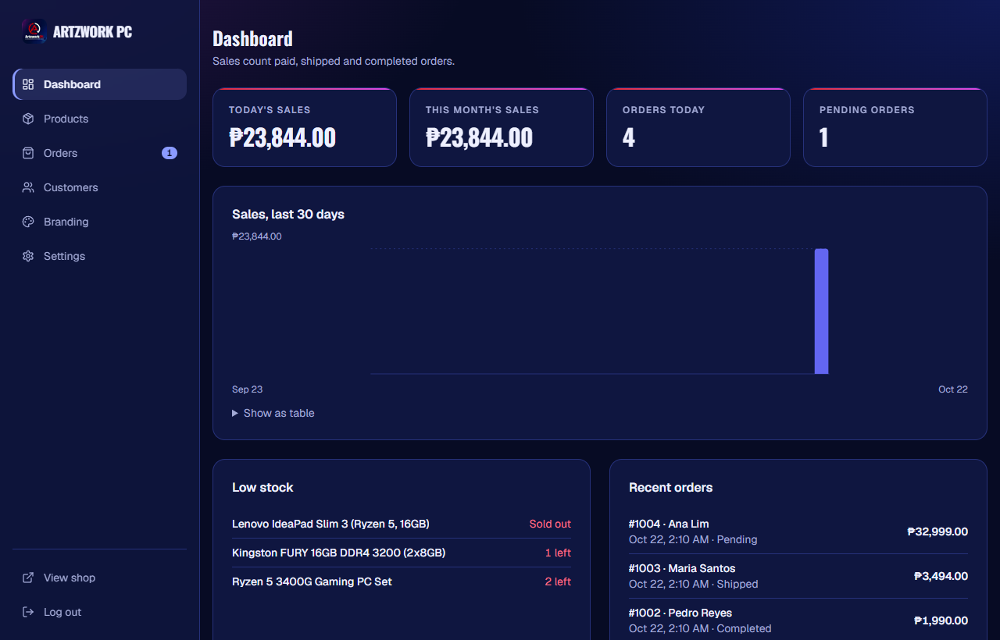
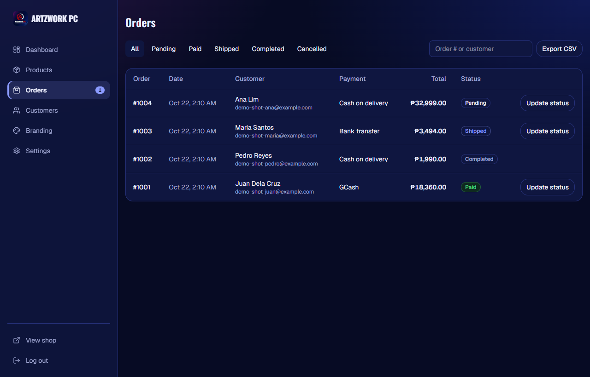
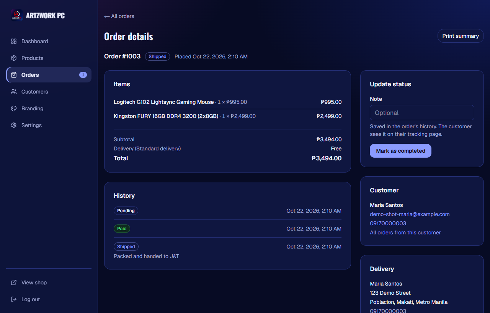
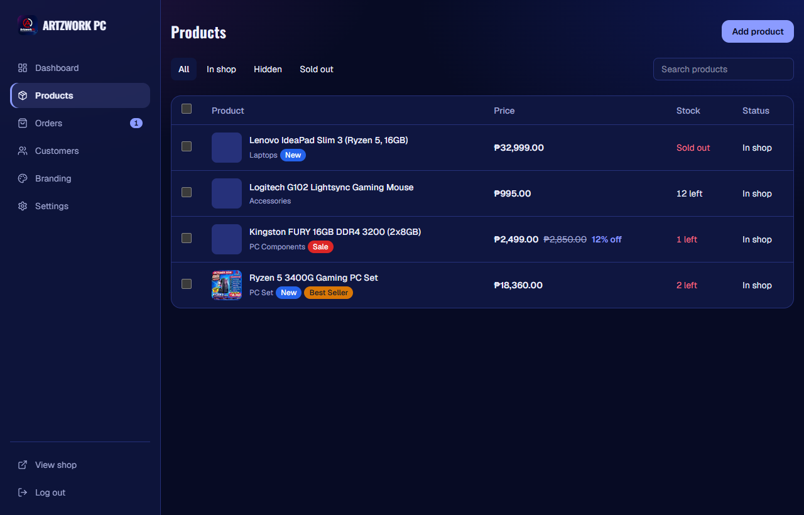

# Artzwork PC

An online store built for a Philippine PC shop: computer parts, PC sets and accessories. A customer **shop** and a seller **admin** run as two sites from one Next.js app, on Supabase.



| Product page | Phone | Admin login |
|---|---|---|
|  |  |  |

### Admin (seller site)



| Orders | Order details | Products |
|---|---|---|
|  |  |  |

<sub>Admin screenshots use demo products and made-up customers.</sub>

## What it does

**Shop (customers)**
- Browse by category, search, filter by price and sort; product pages with photos, sale prices and labels
- Cart, **Order now**, guest or account checkout, store pickup or courier delivery
- Pay by **GCash, bank transfer or cash on delivery**. Each manual order gets a unique amount (total + a few centavos), and the shop's GCash QR is turned into a **QR with that amount already filled in** (QR Ph / EMVCo, CRC-16)
- Order tracking page: status steps, courier and tracking number, cancel until it ships, payment reference fallback; it **updates by itself** when the shop changes the order
- Accounts with email or Google: profile, saved addresses, My orders with a badge for new updates, forgot password, delete account

**Admin (seller)**
- Dashboard with sales, low stock and recent orders; a live **new-order alert** (sound, card, tab title)
- Products with photos, categories, labels and stock; orders with quick status updates, courier details and CSV export
- Customers, branding (logo, banner, colours, contact, Messenger, instalment note) with a live preview
- Payment settings: manual or online per method, and a **free automatic payment check**: the shop's Android phone forwards GCash / bank SMS, and the order waiting for that exact amount is marked paid
- Optional online payments through PayMongo (GCash, online banking) with a signed webhook; a local test payment page when no keys are set

## How it is built

| | |
|---|---|
| **Stack** | Next.js 16 (App Router, Cache Components, server actions), React 19, TypeScript, Tailwind CSS 4, Supabase (Postgres, Auth, Storage) |
| **Two sites, one app** | The proxy picks the site by host (`SELLER_HOST`) and serves the admin from `src/app/(seller)/seller`; logins are separate per site |
| **Hosting** | Netlify Free (two sites from one repo) and Supabase Free; a daily scheduled function keeps the free database from pausing. Runs at no monthly cost |
| **Security** | Row-level security on every table; money and status changes only through `SECURITY DEFINER` functions; payments confirmed only by the server (shared secret, exact amount, idempotent); spam limits on unpaid orders; signed webhooks; password reset only from the email link; the admin has no public sign-up and lets in only the owner's account; security headers (frame-ancestors, nosniff, HSTS) |
| **Speed & cost** | Pages pre-rendered and streamed; catalogue cached with tags and refreshed on change; session read from the ES256-signed token (no Auth round trip); photos shrunk to WebP in the browser before upload and served as AVIF/WebP; unused uploads removed automatically; live pages poll a one-row version check and re-render only on change |
| **Tests** | 70 unit and database tests (`vitest`, Postgres in memory via PGlite) plus browser end-to-end runs of checkout, payments, tracking and password reset |

Architecture decisions: [docs/adr/ADR-001-platform-architecture.md](docs/adr/ADR-001-platform-architecture.md).

## Folders

| Path | What |
|------|------|
| `src/app/(customer)/` | Public shop |
| `src/app/(seller)/` | Admin (private) |
| `src/features/customer`, `src/features/seller` | Each side's components, server actions and queries (lint stops them importing each other) |
| `src/features/shared`, `src/lib` | Shared UI, payments (QR Ph, SMS reader, PayMongo), emails, Supabase clients |
| `supabase/migrations/` | Schema, security policies and database functions |
| `tests/` | Database, payment and email tests |

## Run it yourself

1. Create a free project at [supabase.com](https://supabase.com) (region close to your customers).
2. Copy `.env.example` to `.env.local` and fill in the project URL and publishable key. Put the database URL in `.env.db` as `SUPABASE_DB_URL` (it never leaves your machine).
3. In `supabase/migrations/20261020000600_single_store.sql`, replace `owner@example.com` with the shop owner's email. Only that account can open the admin. The admin has no sign-up page: create that account on the shop's sign-up page, then log in on the admin.
4. Apply the database and start:
   ```
   npm install
   npm run db:push
   npm run dev      # shop: http://localhost:3000   admin: http://admin.localhost:3000
   npm test
   ```
5. In Supabase → **Authentication → URL Configuration**, add `http://localhost:3000/auth/confirm` and `http://admin.localhost:3000/auth/confirm` as redirect URLs.

Optional settings (emails through Resend, PayMongo, the SMS payment check) are described in `.env.example`.

## Go online

The app runs as **two Netlify sites built from the same repo**: one for the shop, one for the admin. Both are free.

1. On Netlify, import the repo twice: once for the shop and once for the admin. `netlify.toml` already holds the build settings (`npm run build`, Node 22, Netlify's Next.js runtime).
2. Give **both sites the same environment variables**: `NEXT_PUBLIC_SUPABASE_URL`, `NEXT_PUBLIC_SUPABASE_PUBLISHABLE_KEY`, `SELLER_HOST` (the admin site's host, e.g. `my-shop-admin.netlify.app`), `SHOP_URL`, `SELLER_URL`, `PAYMENT_CONFIRM_SECRET`, plus any optional ones from `.env.example`.
3. In Supabase → **Authentication → URL Configuration**, set the **Site URL** to the shop's address. Under **Redirect URLs**, add `https://<shop>/**` and `https://<admin>/**`.
4. Each push to `main` redeploys both sites. `netlify/functions/keep-alive.mts` runs once a day and queries the database, so the free Supabase project never pauses for inactivity.
